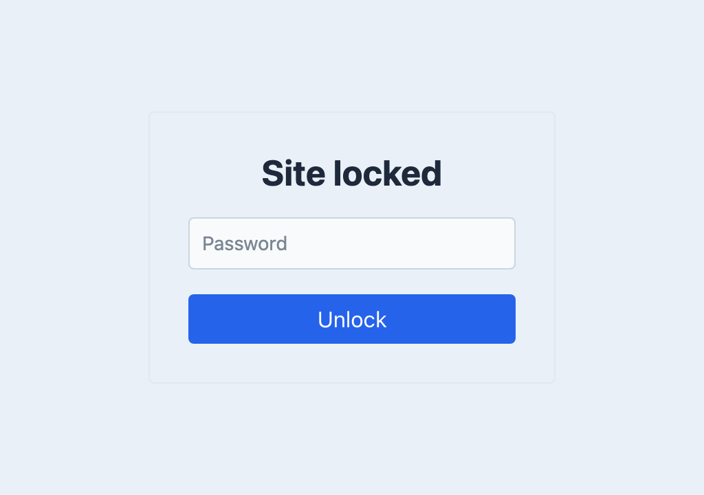

# Usage

Knock Knock places a shared-password gate in front of the protected URLs on your site. It is useful when a site is being prepared for a limited audience. Passing the gate does not sign the visitor in as a Craft user.

The gate covers ordinary page requests. Authenticated Craft users, valid preview/token requests and Craft action requests retain their existing exemptions for compatibility with logins, forms, webhooks and other integrations. Treat those endpoints as separate application surfaces and apply their own authentication and authorization where required.

In the plugin settings, set a password and enable protection. Start with the default gate before creating a custom template. Open a protected page in a fresh browser session, enter an incorrect password to check the error, then enter the configured password and confirm that you reach the page.

Knock Knock remembers access independently for each site until the configured cookie duration ends. Changing a site's effective password invalidates its existing access cookies.



Use `protectedUrls` and `unprotectedUrls` in [Configuration](docs:get-started/configuration) when only part of the site needs the gate. Test a URL from each group, including any public endpoint that must remain reachable. Check from an IP that is not exempted by `allowIps`; an allowed address will not demonstrate the visitor's password prompt.

<span id="security"></span>

## Login Attempt Checks
You can opt to log users' attempts to login to Craft to prevent brute-force attempts. Use the `checkInvalidLogins` [configuration setting](docs:get-started/configuration) to manage this.

**Important:** You must also enable [storeUserIps](https://craftcms.com/docs/5.x/reference/config/general.html#storeuserips) in your `general.php` file.

## Custom Template
Using the `template` [configuration setting](docs:get-started/configuration), you can provide a path to your own custom template, shown to users when they try to login. A very simple example might look like the following:

```twig
<form method="post" accept-charset="utf-8">
    <input type="hidden" name="action" value="knock-knock/default/answer">
    {{ csrfInput() }}

    <label for="password">Password</label>
    <input id="password" type="password" name="password" autocomplete="off" placeholder="Password" autofocus />

    <button type="submit" name="unlock" value="Unlock">Unlock</button>

    
        <ul class="errors">
            
                <li>{{ error }}</li>
            
        </ul>
    
</form>
```

You can also look at the template Knock Knock itself uses [here](https://github.com/verbb/knock-knock/blob/craft-5/src/templates/ask.html). When using a custom template, include the action and CSRF inputs shown above, and keep the password field’s `name` attribute. Knock Knock tracks the destination server-side, so a redirect input is not required (unless you’ve enabled [static caching](#static-caching)). Otherwise, you have complete control over the look and feel of this form.

## Static Caching
By default, Knock Knock sends “no-cache” headers with the password prompt and when redirecting visitors to it, so static caches like [Craft Cloud’s](https://craftcms.com/docs/cloud/static-caching.html) never store them. Otherwise, a cached prompt could be shown to visitors who have already entered the password.

If you’d like the prompt and your protected pages to be statically cached, you can enable the `enableStaticCaching` [configuration setting](docs:get-started/configuration). Knock Knock then changes how it works:

- Visitors who haven’t entered the password are shown the prompt at the protected URL itself (with a `200` status), rather than being redirected to the login path. The prompt doesn’t start a session or set any cookies, so it can be cached.
- Visitors who enter the password get an access cookie (named `knockKnockAccess` by default, configurable with `staticCacheCookieName`) whose value is the same for everyone who has entered the password. It’s derived from the password and your Craft security key, so it can’t be guessed without the password.
- Your static cache includes the cookie in its cache keys, so visitors without it share one cached copy of each page (the prompt), and visitors with it share another (the protected page).

::: danger
Your static cache **must** include the access cookie in its cache keys for every protected URL before you enable this setting. Otherwise, the first copy of a page to be cached would be shown to everyone: either the prompt to visitors who’ve entered the password, or worse, the protected page to visitors who haven’t.
:::

For Craft Cloud, add a [cache rule](https://craftcms.com/docs/cloud/static-caching.html#customizing-cache-keys) to your `craft-cloud.yaml` file that includes the cookie for your protected URLs:

```yaml
cache:
  rules:
    - pattern: /
      cookies:
        - knockKnockAccess
```

Cloud uses the first rule that matches a URL, so if you have other rules whose patterns could match protected URLs, add the cookie to those rules as well. Then enable the setting:

```php
<?php

return [
    'enableStaticCaching' => true,
];
```

Keep the following in mind when using static caching:

- **Changing the password** changes the access cookie’s value, so visitors will need to enter the new password. Clear your static caches afterwards, so pages cached for the old value are removed.
- **The cookie duration** is only enforced by the visitor’s browser, which removes the cookie once it expires. Cached pages are served without involving Craft, so Knock Knock can’t expire access on the server, and changing `cookieDuration` won’t affect visitors who already have the cookie.
- **Logged-in users, allowed IPs and preview requests** can still see protected pages without the password, but those responses won’t be cached.
- **Denied IPs** are still shown the prompt when their requests reach Craft, but a static cache will serve cached protected pages to anyone with a valid access cookie, regardless of their IP.
- **Existing visitors** will need to enter the password again after you enable or disable static caching, as each mode uses its own access cookie.
- **JavaScript is required** to enter the password. The prompt fetches each visitor’s CSRF token with JavaScript after the page loads, so the token isn’t included in the cached HTML.
- **Custom templates** must not set any cookies, or they won’t be cached. In particular, use `{{ csrfInput({ async: true }) }}` rather than `{{ csrfInput() }}` (or enable Craft’s [`asyncCsrfInputs`](https://craftcms.com/docs/5.x/reference/config/general.html#asynccsrfinputs) setting), and don’t extend the control panel’s layouts. They must also include `{{ redirectInput(redirect) }}`, so visitors are returned to the page they requested. See Knock Knock’s own [static caching template](https://github.com/verbb/knock-knock/blob/craft-5/src/templates/ask-static.html) for an example.
- **Multi-site projects** with sites that share a domain should give each site its own cookie name using `siteSettings`, and add each one to their cache rules, so access is remembered independently for each site.
